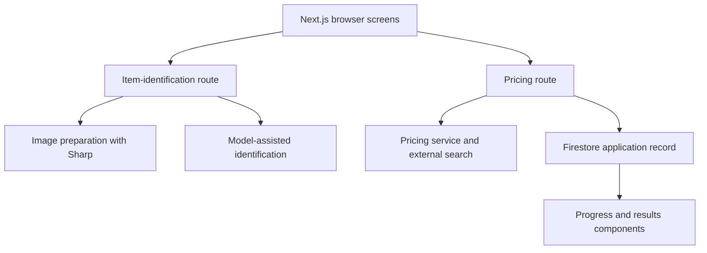

# Auricore

**Identify luxury goods and understand their market value, starting with a photo.**

Auricore helps a user answer “What is this item, and what is it worth?” The web application accepts a photo or manual description, identifies the product, finds comparable listings, and presents market-price research. The broader product connects that valuation workflow to inventory and borrower/lender application intake.

I contributed across the web and mobile applications and built product-data infrastructure behind the catalog. This repository contains the web experience, built with **Next.js, TypeScript and Firebase**.

**Historical UI and architecture reference. Backend integrations are disabled in this portfolio copy.** All `/api` requests return HTTP 503. Original server implementations are preserved as non-executable text in [historical-api](historical-api/README.md). The independent review found missing authentication and ownership checks in those implementations.

## The original user journey

1. **Describe an item.** Upload a photo or enter its details manually.
2. **Identify the product.** Review and refine the application's proposed item match.
3. **Research its value.** Gather comparable listings and display pricing research with progress and results views.
4. **Continue into the marketplace workflow.** The broader application includes borrower and lender intake backed by Firebase.

The engineering work connects image handling, model-assisted identification, external product search, and persistent application state. The repository shows those implementations; valuation accuracy and a live lending service are not established by this source snapshot.

This is a public source snapshot of an existing application. It preserves application source while excluding the original Git history, service-account credentials, local IDE files, and deployment configuration. It has not been deployed or verified against live services as part of this preparation.

[Product ingestion](https://github.com/Jaiashar/luxury-product-ingestion) · [Product canonicalization](https://github.com/Jaiashar/product-canonicalization)

The mobile and supporting-service snapshots are private while their build and authorization gaps remain unresolved.

## Historical request and persistence boundaries

The original Next.js application combined browser screens with server route handlers. The following diagrams describe that historical architecture; the public snapshot does not execute the archived routes. Item identification and pricing research are separate stages: identification proposes what the item is, while pricing gathers evidence about its value. Firebase stores application and per-item pricing state so the interface can present progress and results.



The pricing route accepts identifiers such as `applicationId` and `itemId`, along with the selected item and pricing options. Its persisted state includes per-item status, stage, progress, messages, timestamps, and errors. That is more informative than a single loading flag when different items or external calls take different amounts of time.

### Handling uncertain and slow provider results

The identification route contains retries and several attempts to recover structured JSON from model text. Those fallbacks are implementation behavior, not a guarantee that a repaired response is correct. Pricing code separately defines timeouts and stale-processing checks, and removes undefined values before Firestore writes. Read [identify-item](historical-api/identify-item/route.ts.txt) and [search-pricing](historical-api/search-pricing/route.ts.txt) together to see how model output, persistence, and UI state interact.

Background processing in this historical route should not be assumed to provide durable queue semantics. Deployment lifetime, provider failures, and interrupted writes need testing in the intended hosting environment.

## Code guide

| Flow | Source |
| --- | --- |
| Photo or manual item intake | [app/price](app/price), [PhotoUploader](components/sections/PhotoUploader.tsx), [ManualEntryForm](components/sections/ManualEntryForm.tsx) |
| Item identification and matching | [identify-item](historical-api/identify-item/route.ts.txt), [visionMatchFinder](utils/visionMatchFinder.js) |
| Market-price research and valuation | [search-pricing](historical-api/search-pricing/route.ts.txt), [claudePricingService](utils/claudePricingService.js) |
| Pricing progress and results | [DetailedPricingProgress](components/DetailedPricingProgress.tsx), [EnhancedPricingDisplay](components/EnhancedPricingDisplay.tsx) |
| Borrower and lender applications | [create-borrower](historical-api/create-borrower/route.ts.txt), [create-lender](historical-api/create-lender/route.ts.txt), [lenders](app/lenders) |

## How the pieces fit


The implementation includes image processing with Sharp, model calls through Anthropic and OpenAI integrations, search through SerpAPI, Firebase persistence, and email integration. The archived API integrations are disabled. Some client components also contain direct Firebase operations. Do not supply production Firebase configuration; API isolation does not establish Firestore rules or ownership checks for those client paths.

## Run locally

```sh
npm ci --ignore-scripts
npm test
npm run typecheck
npm run dev
```

This starts the historical UI for inspection; it is not a working end-to-end service. Keep service credentials unset. The example environment file documents historical variables, but copying it and filling in real keys will not enable the archived API handlers.

## Project context

Jai Ashar is the largest contributor in the source repository's recorded commit history. The original history also includes contributions from Dev Ashar and Laura Gao. This snapshot is a portfolio presentation of that collaborative project, not a claim of sole authorship.

The Next.js framework was updated within version 15 during the October 2026 review. Other historical dependencies still have outstanding advisories. This is not a maintained production starter or a statement of valuation accuracy. No new license or third-party asset rights are granted by this publication.

## Validation

TypeScript checking (`npm run typecheck`) and eight offline API-isolation checks (`npm test`) pass. A dated secret scan found no matches in fetched public history. Live integrations were not exercised. Dependency advisories remain; this repository is not deployment-ready. See [PROVENANCE.md](PROVENANCE.md) for the source revision and publication changes.
